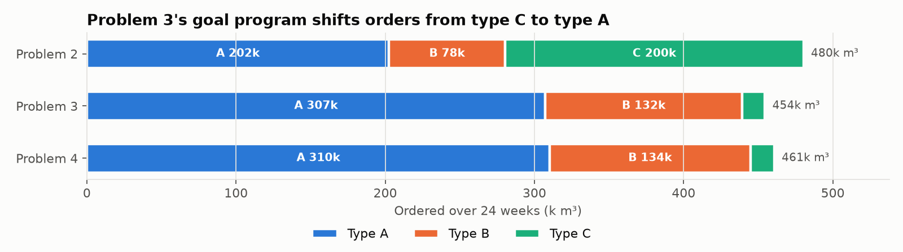
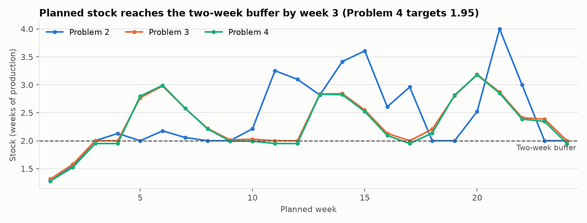
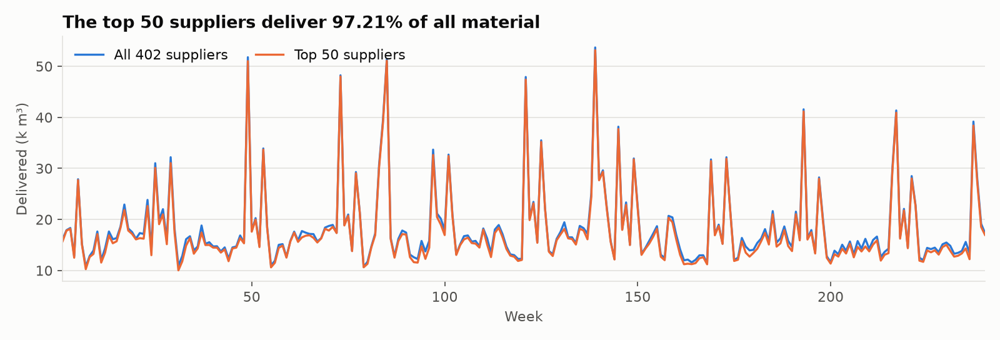
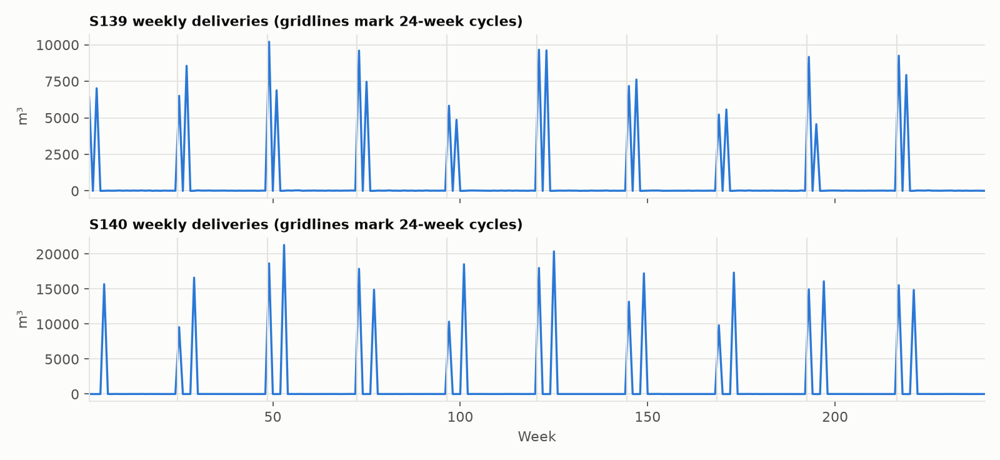

# Raw-Material Ordering and Transshipment Optimization

A Python replication of our solution to **CUMCM 2021 Problem C** (China Undergraduate
Mathematical Contest in Modeling), which won a **First Prize** at the provincial level.
The original was written in MATLAB; this version rebuilds every model with
[linopy](https://github.com/PyPSA/linopy) and the open-source [HiGHS](https://highs.dev) solver,
checks each published number, and documents where the original went wrong.

The work combines three things: **multi-criteria evaluation** (AHP + TOPSIS) to rank 402
suppliers, **seasonal forecasting** of supplier capacity and transit loss, and **linear,
integer and goal programming** to plan 24 weeks of orders and transshipment.

## The problem

A building-board manufacturer makes 28,200 m³ of product a week from three raw materials.
One m³ of product needs 0.60 m³ of type A, 0.66 m³ of type B, or 0.72 m³ of type C. A and B
cost 20% and 10% more than C. Suppliers deliver more or less than ordered, and the company
buys everything delivered. It wants at least **two weeks of production in stock**. Eight
third-party transporters each carry up to 6,000 m³ a week and lose a varying share in transit.

Data: five years (240 weeks) of orders and deliveries for 402 suppliers, and weekly loss
rates for 8 transporters ([`data/raw/`](data/raw)). Original statement:
[`docs/problem_cumcm2021_c_zh.pdf`](docs/problem_cumcm2021_c_zh.pdf).

| # | Question |
|---|---|
| 1 | Quantify supplier characteristics and pick the 50 suppliers most important to production. |
| 2 | Find the fewest suppliers that can meet demand; plan the cheapest 24-week orders and the least-loss transshipment. |
| 3 | Re-plan to buy as much A and as little C as possible, with low transit loss. |
| 4 | How much can weekly capacity grow with the current suppliers and transporters? Plan for it. |

## Results

The numbers this repo's code produces are authoritative. Paper values are shown for
reference only; where they differ, the notes below explain why.

| Quantity | Paper (2021) | This repo | |
|---|---|---|---|
| AHP weights (supply, valid orders, fulfillment, valid rate, fluctuation) | 0.40, 0.11, 0.17, 0.13, 0.19 | 0.399, 0.107, 0.169, 0.132, 0.193 | ✅ |
| AHP consistency ratio | 0.0141 | 0.0090 | ⚠️ see note 1 |
| Top-50 suppliers and their order | table 5 | identical, scores match to 6 decimals | ✅ |
| Top-50 share of all deliveries | 97.21% | 97.21% | ✅ |
| Historical weeks with cumulative supply behind production | 175 / 240 | 175 / 240 | ✅ |
| Minimum suppliers to meet demand | 21 | 21 | ✅ |
| Cheapest 24-week purchase cost (C price = 1) | 570,600 | 528,612.75 | ⚠️ see note 2 |
| Weekly capacity increase | 434.626 m³ | 434.626 m³ | ✅ |
| Simulated shortfall weeks, Q2 / Q3 | ≈ 6 / ≈ 6 | 3.0 / 4.9 | ⚠️ see note 4 |

All rows marked ✅ are pinned by [`tests/test_replication.py`](tests/test_replication.py).
Additional results (see [`outputs/summary.json`](outputs/summary.json)):

| | Problem 2 | Problem 3 | Problem 4 |
|---|---|---|---|
| Ordered over 24 weeks (A / B / C, k m³) | 202 / 78 / 200 | 307 / 132 / 15 | 310 / 134 / 16 |
| Expected transit loss (m³) | 3,143 | 2,196 | 2,288 |
| Weekly capacity (m³) | 28,200 | 28,200 | 28,634.6 |

The goal program in Problem 3 almost eliminates type C (−92%), and its transit loss is
30% lower than Problem 2's, because ordering and routing are solved together.




## Method

### Problem 1: supplier importance (AHP + TOPSIS)

Before scoring, orders with no delivery are treated as recording errors and zeroed out.
Five indicators are then computed for each supplier $i$:

| Indicator | Definition | Measures |
|---|---|---|
| $P_1$ total supply | $\sum_j S_{ij}$ | scale |
| $P_2$ valid orders | $E_i$, orders that were delivered | activity |
| $P_3$ fulfillment rate | $\sum_j S_{ij} / \sum_j O_{ij}$ | reliability |
| $P_4$ valid-order rate | $E_i / (E_i + \bar E_i)$ | robustness |
| $P_5$ fluctuation | $\frac{1}{E_i}\sum_j \lvert O_{ij}-S_{ij}\rvert / O_{ij}$ | stability (cost-type, inverted) |

The weights come from the principal eigenvector of the paper's 5×5 pairwise comparison
matrix (AHP). Suppliers are scored with weighted TOPSIS, by relative closeness to the ideal
and anti-ideal supplier. The top 50 deliver 97.21% of all material.



### Forecasting the next cycle

Deliveries repeat on a **24-week cycle**, the same length as the planning horizon:



Ten past cycles are folded together. The capacity of supplier $i$ in cycle week $w$ is
taken as its best delivery in that week of any cycle,
$\mathrm{cap}_{iw}=\max_p S_{i,24p+w}$. The loss rate of transporter $t$ is the mean of its
non-zero past losses in that week. A transporter with no history for a week is unavailable
that week.

### Problem 2: fewest suppliers, cheapest orders, least loss

Let $m_i$ be the consumption ratio (0.60, 0.66 or 0.72) and $R_k$ the cumulative requirement:
production plus a two-week buffer, with the buffer starting in week 3:
$R_k = 28200\,k + 2\cdot 28200\cdot[k\ge 3]$.

**Fewest suppliers (0-1 ILP).** With $y_i$ = 1 if supplier $i$ is used:

$$\min \sum_i y_i \quad \text{s.t.}\quad \sum_{w\le k}\sum_i y_i\,\frac{\mathrm{cap}_{iw}}{m_i} \ge R_k \quad \forall k$$

**Cheapest orders (LP).** With $x_{iw}\in[0,\mathrm{cap}_{iw}]$ ordered and $p_i$ the relative price:

$$\min \sum_{i,w} p_i x_{iw}\quad\text{s.t.}\quad \sum_{w\le k}\sum_i \frac{x_{iw}}{m_i}\ge R_k,\qquad \sum_i x_{iw}\le \text{fleet}_w$$

**Least-loss transshipment (LP).** With $z_{iwt}\ge 0$ the volume transporter $t$ carries:

$$\min \sum_{i,w,t} \ell_{tw} z_{iwt}\quad\text{s.t.}\quad \sum_t z_{iwt}=x_{iw},\qquad \sum_i z_{iwt}\le 6000$$

### Problem 3: goal programming

Ordering and routing are solved jointly. Each preference becomes a goal with deviation variables:

$$\sum_{i\in A,w} x_{iw} + d_1^- - d_1^+ = \sum_{i,w} x_{iw},\qquad \sum_{i\in C,w} x_{iw} + d_2^- - d_2^+ = 0$$

$$\min\; d_1^- + d_2^+ + \sum_{i,w,t}\ell_{tw} z_{iwt}$$

The constraints are the same as in Problem 2.

### Problem 4: capacity expansion

A capacity increase $D$ enters week $k$ as $(k+2)D$ (production plus buffer), and $\max D$
is solved under the Problem 3 constraints. The result is $D$ = 434.626 m³/week. The plan
for the new capacity reuses the goal program, with the buffer relaxed to 1.95 weeks, as
in the paper.

### Evaluating plans

Each supplier's history is decomposed into level × seasonal index × irregular component. A
plan is simulated 100 times with normally distributed irregular draws. Each run counts the
weeks in which cumulative deliveries fall behind cumulative production.

## Notes on the replication

These are places where the paper and its own published code disagree, or where the code
has a bug. Each one was traced to its source rather than tuned away.

1. **Consistency ratio.** The paper's comparison matrix gives λ_max = 5.040 and CR = 0.009,
   not 0.0141. Both are far below the 0.1 threshold, and the weights match, so no conclusion changes.
2. **Purchase cost.** The LP in the paper's appendix, run on the data, reaches its optimum at
   528,612.75. The text reports 570,600. None of the variants we tried reproduce 570,600:
   the 21-supplier subset, no transport cap, unit cost by volume, or the cost of the floored
   plan. The 570,600 figure probably came from an earlier version of the code.
3. **Infeasible transport step (bug fixed).** The order LP lets each week use the whole
   fleet (8 × 6,000 m³), but the transport LP blocks transporters with no history for a week,
   and in week 1 that leaves only 42,000 m³. The order LP's optimal plan uses 48,000 in week 1,
   so the published transport LP is infeasible. Capping orders at the *available* fleet
   instead gives the **same optimal cost** (this is tested) and a plan that can be shipped.
4. **Simulation.** The Monte Carlo is random and the original seed is unknown, so only the
   order of magnitude can match. Contrary to the paper's text, Problem 3's plan has *more*
   simulated shortfall weeks than Problem 2's, because it orders less in total.
5. **Trend test.** The paper says deliveries have no trend. At p < 0.05, 12 of the top-50
   suppliers do. The original script printed `size(h,1)`, which is always 1 for a row vector,
   so the test result was never actually shown.
6. **Kept as published.** A few modeling choices are kept so that the numbers stay comparable:
   - An order delivered *exactly* is not counted as "valid". Counting it changes only 2 of the top 50.
   - The capacity increase in Problem 4 adds $2D$ of buffer from week 1.
   - Problem 2's orders are floored to whole m³, and Problems 3 and 4 are rounded.
   - The model ignores the rule that one supplier should preferably use a single transporter per week.

## Running it

Requires [uv](https://docs.astral.sh/uv/).

```bash
uv sync
uv run supplychain   # solves Problems 1-4 (~5 s), writes outputs/ and figures/
uv run pytest        # replication checks
```

| Output | Contents |
|---|---|
| `outputs/supplier_ranking.csv` | all 402 suppliers with indicators, score and rank |
| `outputs/order_plans.xlsx` | 24-week order plans for Problems 2-4 (same layout as the competition's Attachment A) |
| `outputs/transport_plans.xlsx` | supplier × week × transporter flows (Attachment B layout) |
| `outputs/summary.json` | every headline number |

## Layout

```
src/supplychain/
  data.py         constants, loaders, cumulative demand
  scoring.py      Problem 1: indicators, AHP, TOPSIS
  forecast.py     cycle folding, capacity and loss forecasts, noise model
  planning.py     Problems 2-4: ILP, LP and goal-programming models
  simulation.py   Monte Carlo evaluation of order plans
  pipeline.py     runs everything in order
  report.py       tables, workbooks, figures
data/raw/         competition data (Attachments 1 and 2)
data/templates/   blank answer templates from the competition (Chinese)
docs/             problem statement and original paper (Chinese)
```

## Why Python + linopy + HiGHS

The models are small: the largest has about 10,800 variables and solves in under a second.
What matters here is how readable the models are and how easy they are to reproduce, not
solver speed. linopy expresses each model in terms of named dimensions
(`supplier`, `week`, `transporter`), so the code reads like the math above. HiGHS is a free
LP/MIP solver that is fast enough for these models, and the whole project installs with
`uv sync` with no license. Julia/JuMP would be an equally good choice. Commercial solvers
such as Gurobi pay off only at a much larger scale.
